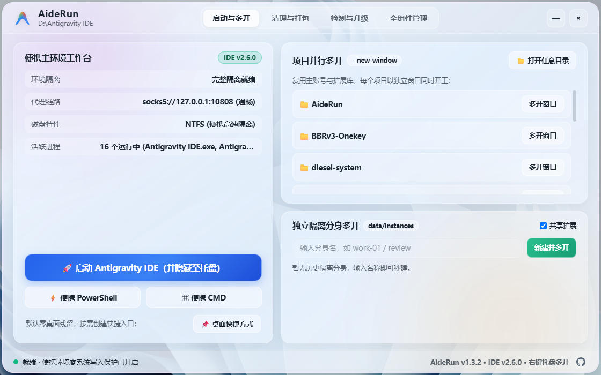
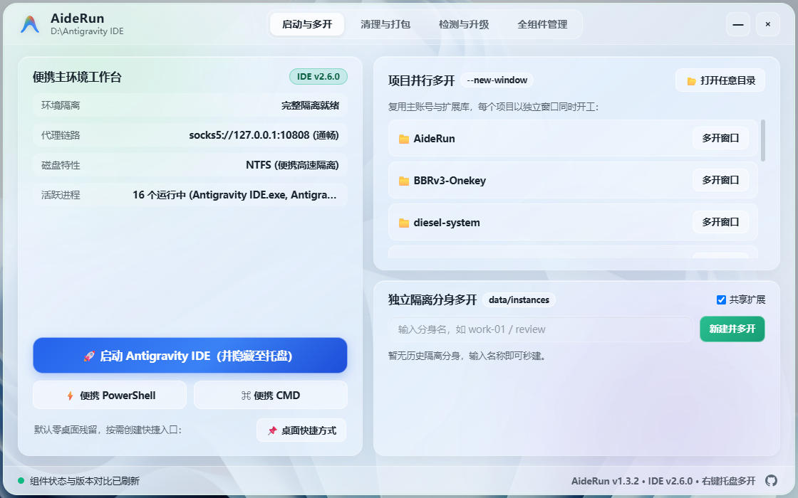
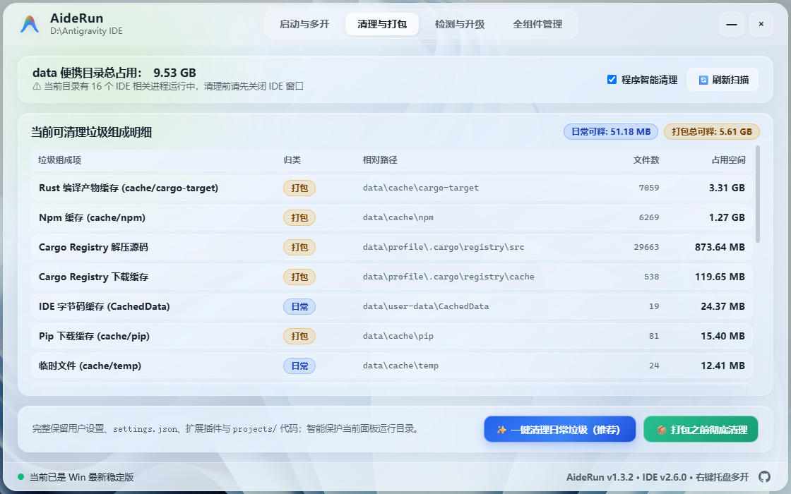
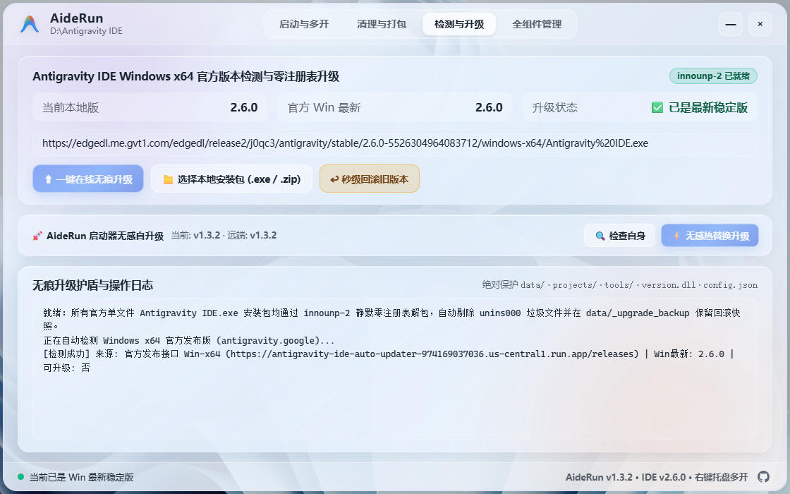
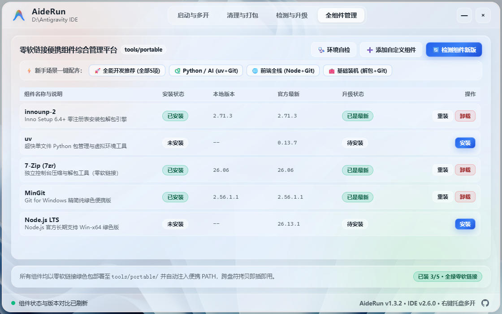

<!-- AideRun - Antigravity IDE 便携版全能启动器项目说明文档 -->
<div align="center">


<h1>AideRun · Antigravity IDE 便携启动器</h1>

**专为极致便携与高洁癖开发者打造的一体化 Antigravity IDE 零污染桌面启动器与全生命周期管家**

集 Antigravity IDE 自动下载、便携部署、日常清理、全组件管理于一体的工具。致力于摆脱系统盘路径污染与复杂环境配置，原生提供启动前智能代理检测、官方原版零注册表一键部署、跨盘符即插即用自愈、自身无感影子热升级、多开分身隔离以及水晶玻璃拟态控制台体验。

<p align="center">
  
  
  
  
  
  
  <a href="https://t.me/YuC2027" target="_blank"></a>
</p>

<h3>
  <a href="#️-使用说明">快速开始</a> · 
  <a href="#-界面实景预览">界面预览</a> · 
  <a href="#-核心功能一览">核心特性</a> · 
  <a href="#-目录结构与源码编译">源码编译</a> · 
  <a href="#-更新日志">更新日志</a> · 
  <a href="#-意见反馈与技术支持">技术支持</a>
</h3>

<br>

</div>

> 💡 **最新版直链下载**：[Release/AideRun.exe](https://raw.githubusercontent.com/ZhangSir9901/AideRun/main/Release/AideRun.exe)（单文件静态编译成品，放入目标目录双击即可自动部署全套便携开发环境）

---

## 🌟 三大核心王牌特性 (Core Highlights)

<table>
  <tr>
    <td width="33%" valign="top">
      <h3>📦 1. 极致便携 · 随身随行</h3>
      <p><b>一个文件夹打包全带走</b></p>
      <ul>
        <li><b>单 exe 零注册表部署</b>：仅需一个 <code>AideRun.exe</code>，自动下载官方内核并原地解包，系统盘与注册表零污染。</li>
        <li><b>数据全闭环收口</b>：深度劫持环境变量，所有配置、插件与缓存彻底收敛在 <code>data/</code> 目录。</li>
        <li><b>U 盘 / 移动硬盘即插即用</b>：换电脑、变盘符时自动重定位索引与配置，专属 IDE 随身跟着走。</li>
      </ul>
    </td>
    <td width="33%" valign="top">
      <h3>⚡ 2. 开箱即用 · 顶配武装</h3>
      <p><b>免 TUN 直连 + 原生汉化 + AI 四大套件</b></p>
      <ul>
        <li><b>免 TUN 强制代理直连</b>：内置集成开源网络补丁，免开 TUN 虚拟网卡即可畅快登录与 AI 对话。</li>
        <li><b>官方内置简体中文语言包</b>：微软官方汉化扩展自动部署与云端自动更新，无外部常驻外挂。</li>
        <li><b>AI 编程四大金刚套件 (4合1)</b>：集成 Google 现代 Web 规范、Context7 最新文档、Chrome DevTools 与 Native Swarm 蜂群协同。</li>
      </ul>
    </td>
    <td width="33%" valign="top">
      <h3>🧰 3. 全组件管理 · 智能清理</h3>
      <p><b>零软链接平台 + 三大核心资产死锁</b></p>
      <ul>
        <li><b>零软链接便携组件平台</b>：彻底摆脱 Scoop，常用开发工具（uv / MinGit / Node / 7z）一键配齐与升级。</li>
        <li><b>双层分级智能清理</b>：日常秒清运行缓存，深度释放构建依赖、AI 暂存工程与调试长日志。</li>
        <li><b>三大受保护资产死锁</b>：账号 Token、基础工具链与各工程 AI 对话库绝对防护，绝不误删。</li>
      </ul>
    </td>
  </tr>
</table>

---

## 📸 界面实景预览

<div align="center">
  <p><b>水 晶 玻 璃 拟 态 主 控 制 台（1120 × 700）</b></p>
  
</div>

<br>

<table>
  <tr>
    <td align="center" width="50%">
      <br />
      <sub><b>启动与多开</b>：主工作台状态透视、项目并行多开与独立隔离分身</sub>
    </td>
    <td align="center" width="50%">
      <br />
      <sub><b>清理与打包</b>：分目录占用明细、程序智能清理与打包前彻底瘦身脱敏</sub>
    </td>
  </tr>
  <tr>
    <td align="center" width="50%">
      <br />
      <sub><b>检测与升级</b>：官方 IDE 零注册表原子升级回滚 &amp; 启动器无感自更新</sub>
    </td>
    <td align="center" width="50%">
      <br />
      <sub><b>全组件管理</b>：零软链接绿色组件（uv / MinGit / Node.js / 7zip / innounp-2）一键配齐</sub>
    </td>
  </tr>
</table>

---

## ✨ 核心功能一览

### 📦 1. 真正的极客便携化部署：一个文件夹打包全带走，U 盘即插即用跨盘自愈
* **单文件启动自愈，彻底脱离系统安装器**：
  若目录中仅存在 `AideRun.exe`，首次双击将自动引导直连官网拉取最新 Windows x64 安装包，调用内置便携 `innounp-2` 完成**零注册表原地静默解包**，全过程不污染系统注册表与开始菜单，若取消则零残留退出。
* **数据全闭环收口，告别 C 盘膨胀**：
  启动时自动深度接管并劫持 `USERPROFILE`、`HOME`、`HOMEDRIVE`、`HOMEPATH`、`APPDATA`、`LOCALAPPDATA`、`CARGO_HOME`、`RUSTUP_HOME`、`NPM_CONFIG_PREFIX` 等全路径环境变量，将所有用户数据、扩展插件、IDE 缓存与工具链彻底锁定在同级 `data/` 目录中。
* **更换电脑 / 盘符变动零感知自愈**：
  将整个文件夹拷贝到移动硬盘或 U 盘，插到其他电脑上即使盘符从 `D:` 变成 `F:`，启动器内置的重定位自愈引擎（`relocate.rs`）会自动秒级重定向扩展清单（`extensions.json`）、最近工作区（`storage.json` / `state.vscdb`）及 `.gitconfig`，带快照备份，专属开发环境随身带走不闪退。

### ⚡ 2. 开箱即用三位一体增强：免 TUN 代理直连 + 原生官方汉化 + AI 超级套件
* **免 TUN 强制代理直连 (`antigravity-proxy v2.6.3`)**：
  全新部署时可选一键集成开源网络劫持补丁（`version.dll` + `config.json`），免开翻墙软件虚拟网卡 TUN 模式，自动挂接本地 HTTP/SOCKS5 代理端口（支持自动检测与单行代理智能解析），彻底解决官方账号直连登录与 AI 对话网络卡顿痛点。
* **官方内置简体中文语言包 (`ms-ceintl.vscode-language-pack-zh-hans`)**：
  部署时自动拉取微软官方内置简体中文语言包注册至便携扩展库，锁定 `data/argv.json` 的 `"locale": "zh-cn"`，并在扩展清单中启用自动更新同步，首次启动即为纯净原生中文界面，无需任何外部常驻外挂或控制台黑窗口。
* **AI 编程超级增强套件 (四大金刚 4合1)**：
  - **首次部署默认集成**，老用户亦可在「全组件管理」一键安装或点击更新；
  - **Google 现代 Web 规范**（`modern-web-guidance-plugin`）：释放最新 Web Platform 平台开发真理库与代码现代性规范，杜绝过时前端写法；
  - **实时文档检索**（`context7`）：官方接入 Context7，实时拉取主流第三方开源库最新官方 API 文档与范式，消除模型过时幻觉；
  - **自动化排错调试**（`chrome-devtools-plugin`）：原生集成 Google Chrome DevTools，赋能智能体深度排错与自动化能力；
  - **多智能体蜂群并行协同**（`swarm`）：集成 Native Swarm 多智能体引擎，支持复杂工程任务拆解与多视角交叉复核。

### 🧰 3. 零软链接便携组件管理平台：告别 Scoop，常用工具链一键配齐与平滑升级
* **零软链接纯绿组件综合管理 (`tools/portable/`)**：
  彻底废弃对 Scoop 繁琐架构与软链接的依赖，采用纯绿色单目录部署（`uv`、`MinGit`、`Node.js LTS`、`7-Zip`、`innounp-2` 等），自动注入便携 PATH，跨盘符拷贝即插即用。
* **新手场景一键配齐与在线检测更新**：
  内置场景预设（Python/AI、全栈 Web、基础装机），一键并发自动下载解压；支持一键探测官方远端最新版本并执行绿色平滑升级，同时支持手动添加自定义组件扩展。

### 🧹 4. 智能垃圾清理与三大核心资产绝对死锁：日常秒清与深度瘦身
* **分级瘦身与垃圾组成透视**：
  智能识别 IDE 进程占用状态，提供「一键日常清理」（秒级清理日志与浏览器运行缓存）与「深度彻底清理」（深度释放跨版本升级解包备份、各语言编译依赖缓存、AI 助手暂存工程包 `scratch/` 与全量长日志 `logs/`，一键释放数 GB 磁盘空间）。
* **三大受保护核心资产绝对死锁**：
  严格保护**账号与登录凭证**（GitHub / Google Token）、**基础开发环境**（`.rustup` / `tools`）与**各工程 AI 对话库**（`conversations/*.db`）绝对不误删；高危清理项强制触发全屏双重弹窗确认机制。

### 🚀 5. 工业级美学 UI、多开分身与自身影子热替换
* **水晶磨砂高透拟态控制台 (1120 × 700)**：
  基于 Rust + tao + wry 原生渲染无边框高透界面，搭载 50ms 驱动 HSL 360° 呼吸流光引擎，统一控制面板与启动前置引导窗口的工业美学风格。
* **工作区多开与独立数据分身**：
  一键系统托盘常驻，支持按项目文件夹独立多开，或通过 `--instance <名称>` 秒建完全隔离的数据分身，内置便携 CMD / PowerShell 终端直启。
* **AideRun 本体影子热替换自升级**：
  主面板启动自动静默比对 GitHub 远端版本，支持状态栏呼吸光效一键升级；通过 PE 校验、`.new`/`.old` 原子重命名与 `--wait-pid` 进程接力，实现零崩溃无感热替换升级。

---

## 🛠️ 使用说明

1. **零基础全新部署**：下载 [`Release/AideRun.exe`](https://raw.githubusercontent.com/ZhangSir9901/AideRun/main/Release/AideRun.exe) 放入希望安放 Antigravity IDE 的文件夹并双击运行，按引导完成代理验证与“是，立即下载部署”即可自动装好全部环境。
2. **已有目录直接接管**：将 `AideRun.exe` 放入已解包的便携版 Antigravity IDE 根目录，双击直接秒进 1120×700 控制面板。
3. **静默直启与命令行**：
   - `AideRun.exe --silent` 或将项目文件夹拖放到图标上：跳过控制面板，注入完整便携环境直启 IDE。
   - `AideRun.exe doctor` / `clean` / `tools list`：支持完整命令行体检、清理与原生零软链接组件管理。

---

## 💻 目录结构与源码编译

```text
AideRun/
├── Release/
│   ├── AideRun.exe           # 最新静态编译成品（供分发与无感自升级）
│   └── update.json           # 远端自升级版本清单
├── assets/                   # WebView2 前端模板（panel.html / preboot.html）与图标
├── src/
│   ├── main.rs               # 入口路由、控制台抑制与 --wait-pid 自升级重启衔接
│   ├── gui.rs                # 主控制台、系统托盘与全局状态事件调度
│   ├── preboot_gui.rs        # 启动前代理检测与官网一键部署双引导子窗口
│   ├── self_update.rs        # AideRun 本体 GitHub 版本探测与影子热替换自升级
│   ├── bootstrap.rs          # 便携骨架搭建、环境诊断与官方安装包解包引擎
│   ├── proxy.rs              # 常见代理端口并发扫描、Google 校验与配置同步
│   ├── env.rs                # 彻底便携环境变量注入（含 HOMEDRIVE / HOMEPATH）
│   ├── upgrade.rs            # Antigravity IDE 内核检测升级与异常回滚
│   ├── clean.rs / sanitize.rs# 垃圾缓存统计清理与 SQLite 隐私脱敏
│   └── ...
├── .cargo/config.toml        # Cargo 编译目标重定向与静态 CRT 配置
└── CHANGELOG.md              # 简体中文版本更新日志
```

### 本地编译要求与命令
- **环境要求**：Windows 10 / 11 (`x86_64`)、Rust `stable-x86_64-pc-windows-msvc` 工具链、MSVC Build Tools、Microsoft Edge WebView2 Runtime。
```powershell
# 运行全部单元测试
cargo test

# 编译 Release 成品
cargo build --release
```

---

## 📋 更新日志

完整版本迭代历史请查看 👉 [CHANGELOG.md](https://github.com/ZhangSir9901/AideRun/blob/main/CHANGELOG.md)

---

## 💬 意见反馈与技术支持

软件在持续优化迭代中，如果您在使用过程中遇到了任何问题、发现 Bug 或有更好的功能建议，**非常欢迎与我联系或提交反馈！** 您的每一个建议都是本工具不断完善的最大动力。

*    **微信咨询**：`jiujiujiayi666` (点击程序界面上的微信图标可直接复制)
*    **Telegram**：[@YuC2027](https://t.me/YuC2027)
*    **官方网站**：[乾旭网络](https://www.qianxu.vip)
*    **开源仓库**：[ZhangSir9901/AideRun](https://github.com/ZhangSir9901/AideRun)
*    **提交 Issue**：欢迎在 GitHub 提交 [Issues](https://github.com/ZhangSir9901/AideRun/issues) 交流探讨。

---

## 👥 贡献者 (Contributors)

感谢所有参与反馈和探讨的朋友们！

<a href="https://github.com/ZhangSir9901/AideRun/graphs/contributors">
  
</a>

## 📈 关注曲线 (Star History)

[](https://star-history.com/#ZhangSir9901/AideRun&Date)

<br>
<div align="center">
  <i>"Talk is cheap. Show me the code." —— 保持热爱，奔赴山海。欢迎大家下载体验并提出宝贵意见！</i>
</div>
